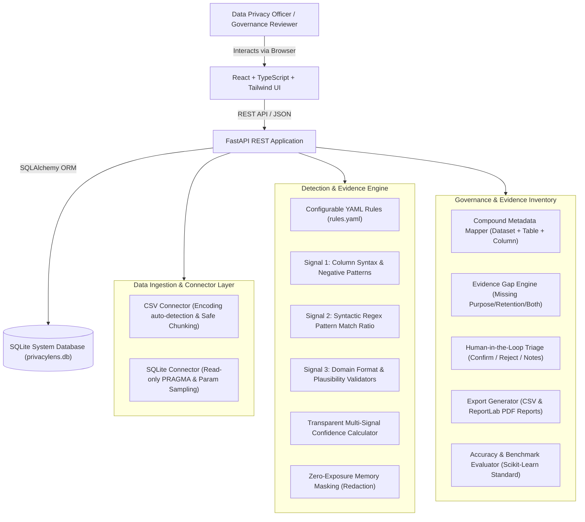
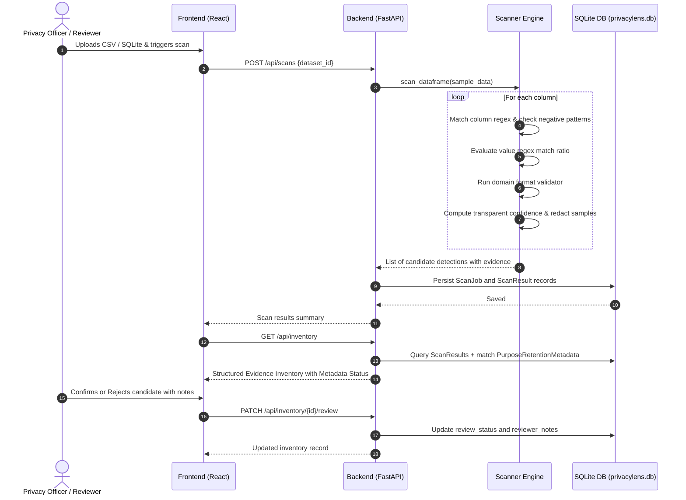

# PrivacyLens — System Architecture & Design Specification

## 1. Executive Summary

**PrivacyLens** is an evidence-based personal-data discovery and privacy evidence inventory platform developed for **AIORI Hackathon 3 (Problem Statement PS-019)**. Organizations routinely accumulate personally identifiable information (PII) across structured files (CSVs) and relational databases (SQLite) without an authoritative inventory linking stored data to declared business purposes, retention periods, or technical evidence.

PrivacyLens discovers candidate personal data fields using a multi-signal transparent detection engine, associates each field with declared purpose and retention metadata, and generates an auditable privacy evidence inventory for human review.

---

## 2. Core Architecture Layers

### Layer 1: Presentation (React + TypeScript)
- Built on Vite, React 18, TypeScript, Tailwind CSS, Lucide icons, and Recharts.
- Persistent cybersecurity slate/navy navigation sidebar (`Sidebar.tsx`) connecting 9 unified workflows:
  1. **Dashboard:** High-level discovery telemetry, data class distributions, confidence spectrum, and recent scan jobs.
  2. **Data Sources:** Upload and manage CSV files and SQLite databases with schema inspection and safe value sampling.
  3. **Scan Data:** Multi-table selection and live discovery scanner execution.
  4. **Evidence Inventory:** Searchable, filterable catalog linking detected candidate fields to declared metadata and confidence scores.
  5. **Purpose & Retention:** Governance register managing declared business purpose and statutory retention rules with CSV import/export.
  6. **Evidence Gaps:** Technical gap identification highlighting missing purposes, indefinite retention, ambiguous mappings, and unreviewed records.
  7. **Evaluation & Accuracy:** Benchmark module computing true positives, false positives, false negatives, precision, recall, and F1 scores against synthetic ground truth.
  8. **Review Center:** Human-in-the-loop triage center to confirm PII, reject false positives, and log justifications.
  9. **Configurable Rules:** In-browser YAML editor to customize detection patterns, scoring weights, and thresholds without engine rebuilds.

### Layer 2: API & Core Application (FastAPI + Pydantic)
- High-performance asynchronous REST API built with FastAPI and Python.
- Pydantic v2 schemas validating request/response payloads with strict typing.
- Threadpool execution for dataset inspection, pandas transformations, and PDF document generation.
- Built-in OpenAPI / Swagger interactive documentation available at `/docs`.

### Layer 3: Connectors & Sampling Layer
- **CSV Connector:** Supports standard, UTF-8, Latin-1, and Windows-1252 encodings; detects header structures; deduplicates identical column names; skips malformed lines; inspects non-null samples.
- **SQLite Connector:** Enforces read-only database connections via URI mode (`file:...ro`); discovers user tables; inspects schema through `PRAGMA table_info`; samples rows safely using parameterized `LIMIT` queries; prevents SQL injection by strictly verifying table names against `sqlite_master`.

### Layer 4: Multi-Signal Detection Engine
Discovers the five required data classes:
1. `person_name`: Human customer and employee names.
2. `email_address`: Standard RFC email syntax.
3. `phone_number`: Indian 10-digit mobile (+91), international E.164 formats.
4. `government_id`: Indian Aadhaar 12-digit format, Indian PAN 10-character alphanumeric, and US SSN candidates.
5. `date_of_birth`: Calendar birth dates (strictly separates DOB from transaction timestamps and created dates).

Combines three independent signals into a transparent confidence score:
$$\text{Score} = (W_{\text{col}} \times S_{\text{col}}) + (W_{\text{val}} \times R_{\text{val}}) + (W_{\text{fmt}} \times R_{\text{fmt}})$$
- Guardrails prevent false positives: negative column patterns (e.g. `product_name`, `company_name`, `order_date`) immediately zero out column weights and cap confidence below discovery thresholds.
- Zero-exposure memory masking: sampled evidence is masked before storage (e.g. `4512 8734 9102` $\rightarrow$ `XXXX-XXXX-9102`), preventing raw PII leaks in logs or reports.

### Layer 5: Metadata Mapping & Evidence Inventory
- Uses compound keys `(dataset_name, table_name, column_name)` to eliminate ambiguous mappings across tables with identical column names (e.g. `email` in `customers` vs `email` in `suppliers`).
- Categorizes metadata completeness:
  - `Complete metadata`
  - `Missing purpose`
  - `Missing retention`
  - `Missing both`
  - `Ambiguous metadata match`
  - `Pending human review`

### Layer 6: Accuracy Evaluation & Reporting
- Evaluates test predictions against synthetic labelled ground truth.
- Computes scikit-learn standard evaluation metrics (TP, FP, FN, Precision, Recall, F1) with explicit zero-denominator handling.
- Generates downloadable CSV exports and formal printable PDF reports via ReportLab.

---

## 3. Data Flow Diagram

